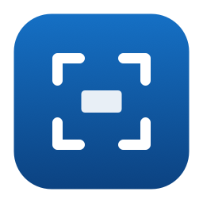

<p align="center">
  <a href="https://github.com/PDGamerSG/sharex-mac/releases/latest">
    
  </a>
</p>

<h1 align="center">ShareX for macOS and Linux</h1>

<p align="center">Take screenshots, copy text from images offline, and find past captures in a local history.</p>

<p align="center">
  <a href="https://github.com/PDGamerSG/sharex-mac/releases/latest"><strong>Download</strong></a> ·
  <a href="#install">Install</a> ·
  <a href="#build-from-source">Build from source</a> ·
  <a href="https://github.com/PDGamerSG/sharex-mac/issues">Report an issue</a>
</p>

ShareX Mac runs in the macOS menu bar. ShareX Linux is a GTK desktop app for Wayland and X11. Both are unofficial ShareX ports that save screenshots and history on your device and recognize text offline. The release page also offers the official ShareX installer for Windows.

## Install

| Platform | Download | Requirements |
| --- | --- | --- |
| macOS | [ShareXMac.dmg](https://github.com/PDGamerSG/sharex-mac/releases/latest/download/ShareXMac.dmg) | macOS 13 or later · Apple Silicon and Intel |
| Linux | [ShareXLinux.deb](https://github.com/PDGamerSG/sharex-mac/releases/latest/download/ShareXLinux.deb) | Tested on Ubuntu 24.04 · x86-64 |
| Windows | [ShareX-22.5.0-setup-x64.exe](https://github.com/PDGamerSG/sharex-mac/releases/download/v1.0.4/ShareX-22.5.0-setup-x64.exe) | Windows x64 · official upstream installer |

### macOS

1. Open the DMG and drag **ShareX Mac.app** into **Applications**. Quit any running copy before replacing it.
2. Open ShareX Mac and choose where to save screenshots. The capture controls open from the menu bar.
3. Allow ShareX Mac under **System Settings → Privacy & Security → Screen Recording**. On newer macOS versions, look for **Screen & System Audio Recording**. Reopen the app if macOS asks.

The app is ad-hoc signed and ships without Apple notarization. If macOS blocks your first launch, open **System Settings → Privacy & Security** and choose **Open Anyway** after the first attempt. Releases through v1.0.3 used a ZIP.

### Linux

From the directory containing the downloaded DEB, run:

```sh
sudo apt install ./ShareXLinux.deb
```

Open **ShareX Linux** from your application menu. Install the capture and clipboard tools for your session as needed.

| Desktop session | Capture | Clipboard and shortcuts |
| --- | --- | --- |
| Wayland | Screenshot portal, or `grim` and `slurp` on compatible compositors | `wl-copy` from `wl-clipboard`. Global shortcuts use the GlobalShortcuts portal where available. |
| X11 | `maim`, GNOME Screenshot, or ImageMagick. Window capture can use ImageMagick with `xdotool`. | `xclip` and Keybinder3. |

The DEB installs GTK and Tesseract dependencies. For additional OCR languages, install the corresponding Tesseract language packages, such as `tesseract-ocr-fra`. The [Linux testing guide](docs/testing/linux-manual-matrix.md) lists settings, history, screenshot, and autostart paths.

### Windows

Run the EXE to install official ShareX 22.5.0. The ShareX team maintains the Windows app, with its own features, release notes, and source. [Official Windows release](https://github.com/ShareX/ShareX/releases/tag/v22.5.0) · [Windows source](https://github.com/ShareX/ShareX/tree/v22.5.0)

## What you get

- **Screen, region, and window capture.** Save lossless PNGs to monthly folders, optionally copy them to the clipboard, and choose a capture delay, cursor visibility, or reduced output size. On Linux, capture options depend on the desktop session.
- **Offline text recognition.** Extract text from a region or from Image History using Apple Vision on macOS or Tesseract on Linux. Successful recognition copies the text to the clipboard. You can edit the result or switch to a single line.
- **Searchable image history.** Preview past captures, open their folders, copy images or paths, and delete captures you no longer need.
- **Global shortcuts.** Open capture, OCR, history, and settings from configurable shortcuts. On Linux, shortcut support depends on the desktop session.

### Default shortcuts

| Action | macOS | Linux |
| --- | --- | --- |
| Capture a region | Option-P | Alt-P |
| Recognize text in a region | Shift-P | Shift-P |
| Cancel capture selection or countdown | Escape | Escape |

Global shortcuts work while the app is running. In **Settings → Hotkeys** on macOS, record a replacement, clear a binding, or choose **Reset all shortcuts** to restore the defaults. Existing installations keep their saved bindings. macOS supports single keys and combinations, including Option-F9. Media-key shortcuts may require Accessibility permission. The app flags duplicate assignments and shortcuts already in use by macOS.

## Build from source

### macOS

Use Xcode 26.6 or a newer macOS toolchain. Run the test suite and build the universal installer:

```sh
swift test --build-system native
scripts/build-release.sh --skip-tests
```

The installer lands in `dist/ShareXMac.dmg`. The [macOS testing guide](docs/testing/macOS-manual-matrix.md) covers permissions, mixed-scale displays, shortcuts, and first-run behavior.

### Linux

Use Swift 6, `pkg-config`, SQLite development headers, `dpkg-deb`, and Python 3 with GTK 3 bindings. The release script checks dependencies, runs the tests, and creates `dist/sharex-linux/ShareXLinux.deb`.

```sh
scripts/build-linux.sh --check-dependencies
scripts/build-linux.sh --release
```

## Contributing

Open an issue with your OS version, app version, and steps to reproduce the problem. For Linux, include your desktop environment and whether you use Wayland or X11. [GitHub Issues](https://github.com/PDGamerSG/sharex-mac/issues)

## License

The macOS and Linux source code is available under the [GNU General Public License v3](LICENSE). See [NOTICE](NOTICE) for attribution and the relationship to [upstream ShareX](https://github.com/ShareX/ShareX).
